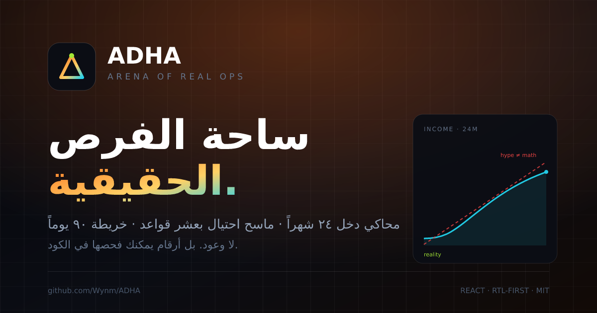

<div align="center">



# ADHA · ساحة الفرص الحقيقية

**ليست قائمة فرص. إنها مختبر قرارات.**

[](https://github.com/Wynm/ADHA/actions/workflows/ci.yml)
[](https://github.com/Wynm/ADHA/actions/workflows/deploy.yml)
[](./LICENSE)
[](#-التشغيل)
[](#)

[الرحلة](#-الرحلة) · [الوحدات](#-الوحدات) · [التشغيل](#-التشغيل) · [المنهجية](./docs/METHODOLOGY.md) · [المساهمة](./docs/CONTRIBUTING.md) · [لماذا](#-لماذا)

</div>

---

## 🎯 ما هذا؟

**ADHA** تطبيق ويب تفاعلي بالعربية (RTL-first) مبني لشباب يريدون الربح من الإنترنت — لكن بدون أن يدفعوا ثمن تجربة كل فخ على حسابه.

الفكرة المحورية: **لا نحتاج وعوداً أكثر، نحتاج قراراً أفضل.** ولهذا كل شيء هنا قابل للقياس والفحص.

| السؤال الذي يبدأ به أغلب الناس | ما تفعله ADHA |
| --- | --- |
| «كم سأربح فعلاً؟» | محاكي 24 شهراً بأربعة منحنيات ومعادلات معلنة |
| «هل هذا العرض نصب؟» | ماسح 10 أنماط + مختبر تبنيه بنفسك لتفهمه للأبد |
| «من أين أبدأ؟» | بوصلة من 4 أسئلة ← مسار واحد، لا عشرة |
| «كم عميلاً أحتاج؟» | حاسبة عكسية تحوّل الهدف إلى وحدات وساعات/يوم |
| «ماذا أفعل غداً؟» | خريطة 90 يوماً + متتبّع 30 يوماً يُحفظ محلياً |
| «ما احتمال أن أتوقف؟» | **تشريح الفشل** — خمسة عوامل ← مؤشر بقاء |
| «ماذا أكتب للعميل؟» | بنك 8 نصوص جاهزة (سعر، رفض، متابعة، مطالبة) |
| «كيف أشارك أصدقائي؟» | بطاقة PNG تُرسم من أرقامك أنت |
| «أين أنا اليوم؟» | **مؤشر ADHA**: ستة أبعاد ← رقم واحد ← ثلاث خطوات |

> ⚠️ **ADHA لا يضمن أي دخل.** كل الأرقام نماذج رياضية محافظة، مكتوبة في ملفات صغيرة يمكنك قراءتها وتعديلها. راجع [المنهجية](./docs/METHODOLOGY.md).


---

## 🗺️ الرحلة

عشرون أداة لا تُستخدم بعشوائية. هذا ترتيبها — وكل مرحلة فيها شريط تقدّم محسوب من بياناتك الفعلية:

| # | المرحلة | الأدوات | السؤال الذي تُجيب عنه |
| --- | --- | --- | --- |
| 01 | **اعرف نفسك** | بطاقة القرار · البوصلة · تشريح الفشل · خزانة الأصول | أين أقف اليوم؟ وما احتمال أن أستمر؟ |
| 02 | **تحصّن** | الماسح · مختبر الاحتيال · لعبة نصب أم عمل | كيف لا أخسر قبل أن أربح؟ |
| 03 | **اختر وشخّص** | الساحة · المحاكي · الحساب العكسي · قيمة المال · أين تبيع | أي طريق؟ وكم وحدة؟ وكم ساعة يومياً؟ |
| 04 | **نفّذ** | مسار التعلّم · خريطة 90 يوماً · المتتبّع · بنك النصوص | ماذا أفعل هذا الأسبوع؟ |
| 05 | **راجع وشارك** | المراجعة · الحالات · المعجم · البطاقة · تصدير الخطة · البيان · الأسئلة | هل أنا أتقدّم فعلاً؟ |

> ملاحظة صريحة: مرحلة **التحصّن** لا تُقاس بالأرقام — لهذا شريطها يبقى صفراً. من يعطي نفسه علامة كاملة في تجنّب الفخاخ لم يفهمها بعد.

---

## 🧩 الوحدات

<table>
<tr>
<td width="50%" valign="top">

### 1. الساحة · Arena
ثمانية مسارات ربح — من صيد الثغرات إلى الـ Micro-SaaS — كل واحدة بمخاطرة معلنة، وقت واقعي لأول دولار، رأس مال مطلوب، وشرط «دليل» يجعلها حقيقية لا شعاراً.

### 2. المحاكي · Simulator
أربعة مسارات × 24 شهراً. منحنى تراكمي/شهري، مقارنة الأربعة بنفس الساعات، سعر ساعتك الفعلي، وزر يعرض **منحنى الوعود الوهمية** (نمو 45% شهرياً) بجانب الواقع.

### 3. الماسح · Shield
الصق أي عرض مشبوه ← درجة 0–100 مع وزن وسبب لكل قاعدة. يعمل بالكامل في متصفحك؛ لا يوجد خادم يستقبل نصك.

### 4. مختبر الاحتيال · Scam Lab
ابنِ العرض المزيّف مكوّناً مكوّناً، وشاهد الدرجة ترتفع واقرأ القاعدة التي كشفته. ثم اضغط «اجعلها صادقة» وفرق الدرجة هو الدرس.

</td>
<td width="50%" valign="top">

### 5. البوصلة · Compass
أربعة أسئلة (مهارة، وقت، حاجة، قدرة تحمّل) ← مسار واحد مع «ابدأ هنا» و«لا تفعل هذا».

### 6. تشريح الفشل · Pre-Mortem
بدل «كيف أنجح؟» نسأل «تخيّل أنك فشلت بعد 6 أشهر — لماذا؟» خمسة عوامل موزونة ← مؤشر بقاء + أضعف الحلقات + حركة واحدة.

### 7. الحساب العكسي · Calc
هدف شهري ← عدد وحدات ← ساعات/يوم ← هل هذا ممكن بشرياً؟ مع جدول حساسية: ماذا لو رفعت السعر ×2؟ 12 عملة عربية.

### 8. الخريطة والمتتبّع · Roadmap & Tracker
90 يوماً في ثلاث مراحل (أوقف النزيف → اصنع دليلاً → اقبض أول دولار)، ثم شبكة 30 يوماً بسلسلة التزام حقيقية.

### 9. النصوص والحالات والمعجم
8 قوالب مراسلة قابلة للنسخ، 3 ملفات حالة بخطة شهر بشهر و**ما يكسرها**، و36 مصطلحاً قابلاً للبحث.

### 10. البطاقة وتصدير الخطة
بطاقة PNG تُرسم على canvas من أرقامك، ووثيقة Markdown كاملة (خطتك) تُنزَّل بضغطة، ونسخة JSON احتياطية.

### 11. بطاقة القرار · مؤشر ADHA
ستة أبعاد مرجّحة (أصول 22 · تنفيذ 20 · اتجاه 18 · وعي 16 · خطة 14 · استمرار 10) ← رقم 0–100 ← خمسة مستويات مسمّاة ← **ثلاث خطوات تالية** مشتقة من أكبر ثغرة. مع رادار SVG يُحدَّث لحظياً.

### 12. قيمة المال وأين تبيع
1000$ عبر 12 بلداً عربياً (نسبة لمتوسط الأجر، أشهر إيجار، احتياطي 3 أشهر) · رسوم 6 قنوات بيع مع حساب **السعر المطلوب (gross-up)** لتصل لصافي هدفك.

### 13. خزانة الأصول ومسار التعلّم
ثمانية أصول × أربع درجات نضج ← «الثغرة الأولى» بخطوة تنفيذية · مسار 8 أسابيع × 3 تخصصات × مخرج أسبوعي، صفر كورسات مدفوعة.

</td>
</tr>
</table>

**+ حرس محتوى آلي**: اختبار يفشل البناء إذا ظهر أي «وعد دخل» أو «ربح مضمون» في أي ملف محتوى.

**+ لوحة أوامر `⌘K` / `Ctrl+K`** للتنقل بين كل الأقسام.
**+ جولة ترحيب** لأول زيارة، و**رابط تخطٍّ** و`focus-visible` واضح للوصولية.
**+ PWA**: قابل للتثبيت ويعمل دون إنترنت.
**+ حالة واحدة مشتركة**: كل ما تختاره في قسم يظهر في الباقي ويُحفظ في `localStorage`.

---

## 🚀 التشغيل

```bash
npm install
npm run dev      # http://localhost:5173
npm test         # 38 اختباراً
npm run build    # dist/ + service worker
npm run preview  # معاينة الإنتاج
```

لا مفاتيح API، لا قاعدة بيانات، لا تحليلات، لا خادم. الرسوم البيانية تُحمَّل عند الطلب (code-splitting).

### النشر
- **GitHub Pages**: جاهز عبر `.github/workflows/deploy.yml` (فعّل Pages ← Source: GitHub Actions).
- **Vercel / Netlify / Cloudflare Pages**: ادفع المستودع، أمر البناء `npm run build`، مجلد الإخراج `dist`.

---

## 🧠 كيف حُسبت الأرقام؟

```js
freelance(net) = price(t) × hours × utilization(t) × 4.345 × 0.94
saas(net)      = mrrCap × (1 − e^−0.105·t)^1.15 − support(t)
content(net)   = views(t) × view→buyer × ARPU + ads
product(net)   = units(t) × price + launch + relaunch

score(scam)    = clamp(0, 100, Σ weights + Σ negative_signals)
survival(pm)   = Σ(option_value × factor_weight)   // مجموع الأوزان = 100
```

**افتراضات متعمّدة:**
- النمو لوجستي/إشباعي، لا أُسّي (الواقع لا يتضاعف كل شهر).
- أول 1–3 أشهر: دخل ≈ 0 في معظم المسارات — مذكور لا مخفي.
- الرسوم مخصومة (5–12%).
- الدخل مقسوم على **كل** الساعات، بما فيها ساعات التعلّم.

التفاصيل الكاملة مع جدول الأوزان والحدود: **[docs/METHODOLOGY.md](./docs/METHODOLOGY.md)**

---

## 🧪 الاختبارات

```
tests/scam.test.js       7   محرك كشف الاحتيال (عتبات، تدرّج، إشارات سلبية)
tests/simulator.test.js  8   المنحنيات (24 شهراً، عدم السلبية، التدرّج بالساعات)
tests/plan.test.js      10   توليد الخطة + منطق البوصلة (كل التركيبات)
tests/premortem.test.js  6   التقييم، الأحادية، تغطية النطاق 0–100
tests/scamlab.test.js    7   تطابق مكوّنات المختبر مع القواعد + النصوص
tests/game.test.js       4   16 بطاقة متوازنة + تغطية التصنيفات
tests/purchasing.test.js 5   التحويل، الرتابة، تطابق الأحكام
tests/platforms.test.js  5   الرسوم، gross-up، عدم السلبية
tests/assets.test.js     9   الخزانة (أوزان=100، ثغرات، رتابة) + المنهج
tests/journey.test.js    5   كل قسم مُفهرس وكل رابط صحيح
tests/index.test.js      6   المؤشر: الحدود، المستويات، الرتابة، الخطوات
tests/content.test.js    6   حرس المحتوى: لا وعود دخل، لا مبالغة، اكتمال الحقول
                       ──
                       79   ✅
```

CI يشغّل `npm test` + `npm run build` على كل push وPR.

---

## 🛠 التقنيات

React 19 · Vite 8 · Tailwind 3 (RTL) · Framer Motion · Recharts · Canvas 2D · vite-plugin-pwa · Vitest

```
src/
├── data/          # المحتوى القابل للتحرير (فرص، خريطة، حالات، معجم، نصوص)
├── lib/           # المنطق الخالص: simulator، scamRules، premortem، plan، sharecard
├── components/    # واجهات مستقلة، كل قسم ملف واحد
└── styles/
```

فصل `lib` عن `components` مقصود: كل المنطق قابل للاختبار بلا متصفح.

---

## 💡 لماذا؟

هناك اقتصاد كامل مبني على بيع أوهام «الربح من الإنترنت» لشباب عربي يملك الوقت والحماس ولا يملك المعلومة. النتيجة أغلب الوقت: خسارة مال قليل، واكتشاف متأخر جداً أن الطريق كان موجوداً كل الوقت — فقط أبطأ وأصدق.

ADHA موجودة لتقول ذلك **قبل** أن يدفع أحد ثمن الاكتشاف.

**ثلاث أفكار تُلخّص المشروع:**

1. **الوقت أغلى رأس مال** — فاختر ما يرفع سعر ساعتك القادمة.
2. **الدليل قبل الضجيج** — رقم قابل للقياس أفضل من صورة ربح.
3. **أصل واحد قبل كل شيء** — لا تشترِ قبل أن تبيع.

---

## 📄 الترخيص

MIT © EL GHRIBI SOUFIAN (Wynm) — استخدمه، انسخه، طوّره، وعلّم به.

<div align="center">

**صُنع ليُقرأ مرتين: مرة الآن، ومرة بعد 90 يوماً.**

</div>
